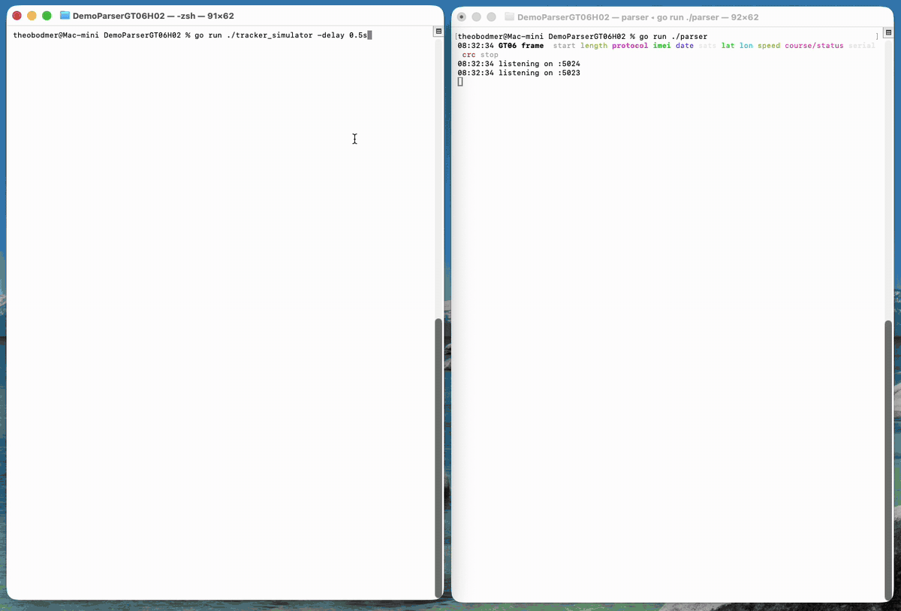

# gt06-h02-go

A small, readable Go listener for the two protocols most low-cost GPS trackers
speak: **GT06** (binary) and **H02** (text, `*HQ,…#`). It comes with a simulator
that replays recorded tracker sessions against it. Both use only the Go standard
library.

It is meant for anyone writing their own tracker parser. The comments in
[`parser/main.go`](parser/main.go) are the real documentation: they record what
devices actually send, including where they differ from the protocol PDFs.



> **Demo code, not production.** It decodes and prints; it stores nothing.
> Use it to learn the protocols or as a starting point for your own listener.

## Quick start

Requires Go 1.25 or newer.

```bash
git clone https://github.com/Insafety/gt06-h02-go.git
cd gt06-h02-go

go run ./parser                          # terminal 1: GT06 on :5023, H02 on :5024
go run ./tracker_simulator -real -speed 15   # terminal 2: replay the recorded sessions
```

To point a real tracker at it, run the parser on a host the tracker can reach
and set the tracker's server to that host and port 5023 (GT06) or 5024 (H02).

## What the output means

Plain output (`go run ./parser -color=false`) of one recorded EC33 session: the
raw frame, the decoded message, and the ack the parser sends back.

```
GT06 raw     78780d0101234567890123450278512b0d0a
GT06 login   imei=123456789012345
GT06 ack     787805010278042a0d0a
GT06 raw     787826121a09170a1f38cf0515172e00eb4d8d1a54d700e40200000000000100000000051d0265d2050d0a
GT06 pos 12 imei="123456789012345" 2026-09-23 10:31:56 +0000 UTC lat=47.371261 lon=8.567118 speed=26 course=215 sats=15 gpsinfo=12 fix=true acc=true status=54d7 len=38 serial=0265 mcc=228 mnc=2 lac=0 cell=0 | 00e40200000000000100000000051d
GT06 ack     787805120265a5bf0d0a
GT06 raw     78780a134606040002027946100d0a
GT06 status  imei="123456789012345" battery=6/6 signal=4 acc=true terminal=46 alarm=00 lang=02 serial=0279
GT06 ack     787805130279258e0d0a
```

Everything after `|` is the part of the frame between the course/status word
and the serial, printed raw so you can match it against your own device.
In a terminal the same output is coloured: each raw frame is split into its
fields, and ignition changes and SOS get their own alert lines.

## What it decodes

| Protocol | Message | Decoded |
|---|---|---|
| GT06 | `0x01` login | IMEI (the only message that carries it) |
| GT06 | `0x12` position | time, lat/lon, speed, course, fix, satellites, cell tower; ACC on the 38-byte variant |
| GT06 | `0x13` status / heartbeat | ACC, battery level 0–6, GSM signal, alarm, language |
| GT06 | `0x16` alarm | position plus alarm cause (`0x01` = SOS) |
| GT06 | `0x22` position | as `0x12`, with a BCD date |
| GT06 | anything else | acked, so the device does not re-send it, but not decoded |
| H02 | `V1`, `V8`, … | time, lat/lon, speed, course, fix, ACC, SOS; battery on `V8`; extra fields printed by index |

## Lessons for your own parser

Each point is explained where it happens in [`parser/main.go`](parser/main.go).

1. **TCP is a stream, not messages.** One read can hold two frames or half of
   one. Cut whole frames out first (`splitGT06`, `splitH02`), then decode.
2. **A GT06 device's identity is its connection.** Only the login carries the
   IMEI. Keep it, and any other state, per connection, and drop it when the
   connection closes.
3. **Ack every GT06 packet, with its own serial.** The serial sits right before
   the CRC, at an offset that depends on the packet length. The CRC is
   CRC-16/X-25. A wrong ack looks exactly like no ack: the device keeps
   re-sending.
4. **Coordinates are unsigned.** The hemisphere comes from bits 10 and 11 of the
   course/status word.
5. **ACC is not in the same place on every model.** The `0x13` status packet
   (terminal-info bit 1) is the one place every GT06 reports it. The EC33 also
   sends it in byte 30 of the long `0x12` and in course bit 14. Traccar reads
   bit 15 there instead, which is always 0 on the EC33.
6. **"No fix" positions can still carry coordinates.** Those are stale; storing
   them as real positions creates phantom trips.
7. **Battery in `0x13` is a level from 0 to 6, not a percentage.**
8. **H02's status word is active-low.** A bit reads 0 while its condition holds:
   bit 1 clear = SOS pressed, bit 18 clear = ignition on. Speed is in knots.
9. **Models disagree.** `0x22` dates are BCD on the devices we have seen, but
   Traccar reads them as plain bytes. Check every field against your own device.

## Repository layout

```
parser/
  main.go            decoding: framing, GT06 and H02 messages, acks
  show.go            coloured terminal output only
tracker_simulator/
  main.go            replays sample sessions over TCP
  show.go            coloured terminal output only
  samples/
    log_gt06/<imei>/<session>.txt   one file per recorded GT06 connection
    h02-log.txt                     H02 messages
docs/
  demo.gif
```

## Parser options

| Flag | Default | Meaning |
|---|---|---|
| `-color` | on in a terminal | Colour the log: raw frames split into their fields, a headline per message, SOS and ignition alerts. Off with `-color=false` or `NO_COLOR=1` |
| `-width` | `80` | Wrap coloured lines at this many columns; `0` turns wrapping off |

With colour off, the output is the plain reference log shown above.

## Simulator options

| Flag | Default | Meaning |
|---|---|---|
| `-dir` | `tracker_simulator/samples` | Folder with `log_gt06/<imei>/*.txt` and `h02-log.txt` |
| `-host` | `localhost` | Listener host |
| `-gt06`, `-h02` | `5023`, `5024` | Listener ports |
| `-delay` | `3s` | Pause between messages |
| `-real` | off | Replay the GT06 sessions on their recorded timeline: each device connects when its session started, one connection at a time, interleaved with the others as recorded |
| `-speed` | `1` | With `-real`, play the recording this many times faster (`-real -speed 15` fits the 13-minute sample into about a minute) |
| `-move` | `0` | Drive GT06 devices in circles at this speed (km/h), rewriting coordinates and CRCs |
| `-merge` | off | Send messages two per write, as one TCP segment |
| `-split` | off | Send each write in two halves, 200 ms apart |
| `-color` | on in a terminal | Colour the log: packet type, progress per device, and the acks the parser sends back. Off with `-color=false` or `NO_COLOR=1` |

`-merge` and `-split` reproduce what mobile networks do to TCP. Run them to
check that your framing holds up:

```bash
go run ./tracker_simulator -delay 200ms -merge
go run ./tracker_simulator -delay 200ms -split
```

## Sample data

The GT06 samples are 15 sessions recorded from five real trackers (an EC33 and
four other GT06 devices) on 23 September 2026, with the IMEIs replaced by
`123456789012341` to `123456789012345`. Each line is `<unix-ms> <hex frame>`,
exactly as the device sent it. The H02 sample is synthetic, one raw message per
line.

To replay your own captures, save them in the same layout and pass `-dir`.

## GT06 vs H02 at a glance

| | GT06 | H02 |
|---|---|---|
| Encoding | Binary, `78 78 … 0d 0a` | ASCII, `*HQ, … #` |
| Framing | Length byte after `78 78` | Ends at `#` |
| Device ID | Only in the login packet | In every message |
| Session state | IMEI and ACC per connection | None |
| Server reply | Ack with serial + CRC-16/X-25 | None |
| Coordinates | Unsigned, minutes × 30000 | NMEA `ddmm.mmmm` |
| Speed | km/h | knots |

## Further reading

- [Traccar's GT06 decoder](https://github.com/traccar/traccar/blob/master/src/main/java/org/traccar/protocol/Gt06ProtocolDecoder.java)
  covers many more models and message types; its
  [frame decoder](https://github.com/traccar/traccar/blob/master/src/main/java/org/traccar/protocol/Gt06FrameDecoder.java)
  sizes frames the same way `splitGT06` does.
- [Traccar's H02 decoder](https://github.com/traccar/traccar/blob/master/src/main/java/org/traccar/protocol/H02ProtocolDecoder.java)

## License

[MIT](LICENSE)
